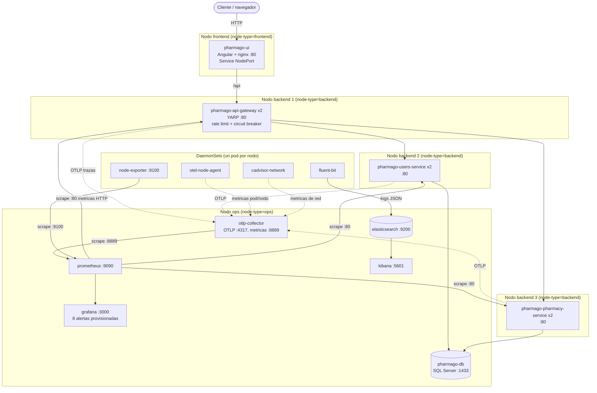

# Diagrama de despliegue

Plataforma PharmaGo sobre Kubernetes, namespace `pharmago`. Fuente: manifiestos de `Implementacion K8S/Codigo/k8s/` (base y overlays `local` y `multinode`). Cubre el requisito de la rúbrica "diagrama de despliegue de los componentes principales".

## Perfil `multinode`

Cada microservicio corre en su propio Deployment y pod. La separación entre servicios se impone con `nodeAffinity` (solo nodos con `node-type=backend`) y `podAntiAffinity` obligatoria: Gateway, Users y Pharmacy no pueden compartir nodo entre sí. Los nodos backend llevan el taint `pharmago.io/dedicated=backend:NoSchedule`. `configure-nodes` exige al menos tres nodos backend, uno frontend y uno ops.

Líneas continuas: tráfico de negocio y flujos de datos (incluido el scrape de Prometheus). Líneas punteadas: telemetría emitida por OTLP. La ubicación de cada servicio en su nodo es la esperada con la configuración y se verificó solo en cuanto a scheduling (ver la sección siguiente).

## Perfil `local`

Mismo conjunto de pods en un único nodo Minikube (`node-type=all`). Las afinidades entre servicios no se aplican, y el gateway mantiene 2 réplicas, mientras que Users y Pharmacy quedan con 1. Sirve para desarrollo y para los ensayos de caos, pero **no demuestra separación entre nodos**.

## Réplicas

| Componente | `local` | `multinode` |
| --- | :---: | :---: |
| pharmago-api-gateway | 2 | 2 |
| pharmago-users-service | 1 | 2 |
| pharmago-pharmacy-service | 1 | 2 |
| UI, SQL Server y stack de observabilidad | 1 | 1 |

## Qué garantiza y qué no

- Garantiza (por configuración): ningún pod de Gateway, Users o Pharmacy se programa junto a pods de los otros dos servicios.
- Las dos réplicas de cada servicio comparten nodo (`podAffinity` obligatoria hacia sí mismo: sin ella, con antiafinidad entre servicios, el scheduler puede repartir un servicio en dos nodos y dejar a otro en `Pending`; ver la evidencia de control). Con 3 nodos backend cada servicio ocupa exactamente un nodo y no hay pods en `Pending`, tampoco durante un rolling update. Ubicación verificada en un Minikube de 5 nodos (solo scheduling, sin imágenes ni tráfico): ver [evidencia](evidencias/multinode-scheduling-20261110.txt).
- Consecuencia: las 2 réplicas protegen frente a fallas de pod y a rolling updates, **no frente a la caída del nodo** que las aloja (el servicio completo queda caído hasta que el nodo vuelva).
- Minikube multinodo corre los nodos como contenedores o máquinas virtuales en una sola computadora. Demuestra la separación entre nodos de Kubernetes, **no** entre nodos físicos distintos, y así debe decirse en el informe.
- SQL Server, Elasticsearch y el resto de la observabilidad tienen una sola réplica: son puntos únicos de falla fuera del alcance del plan.
